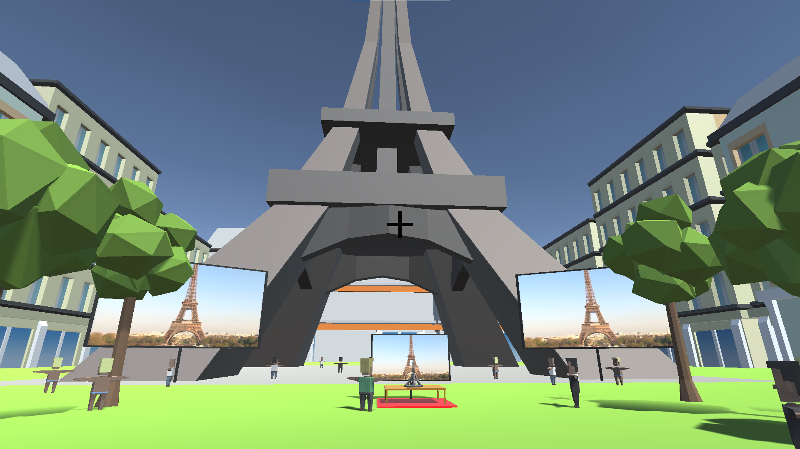
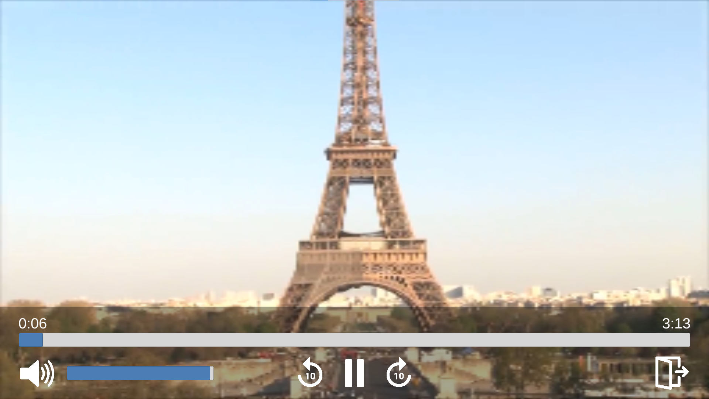
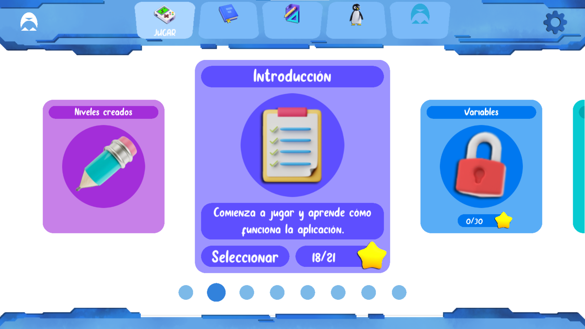
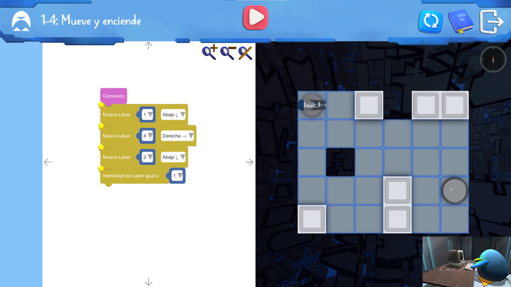
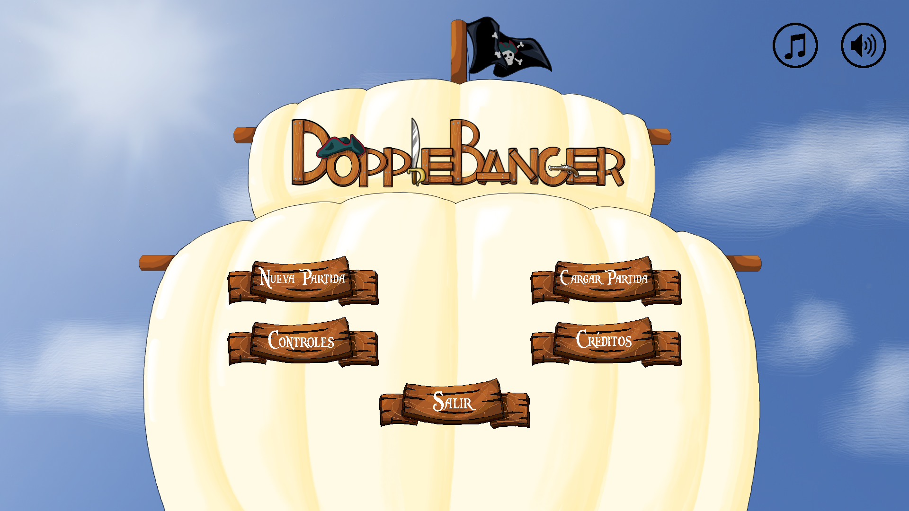
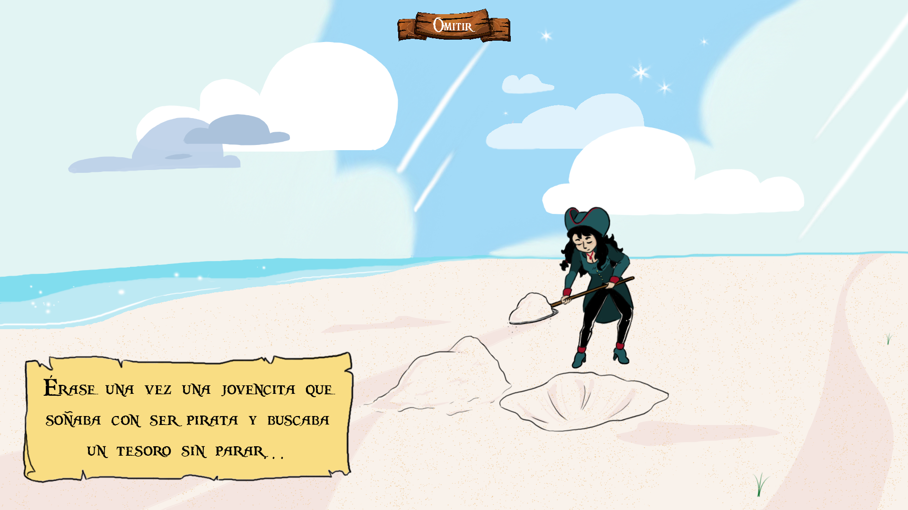
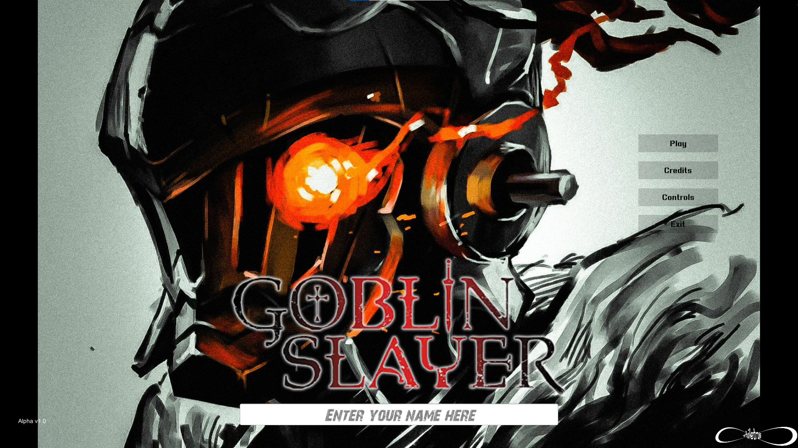
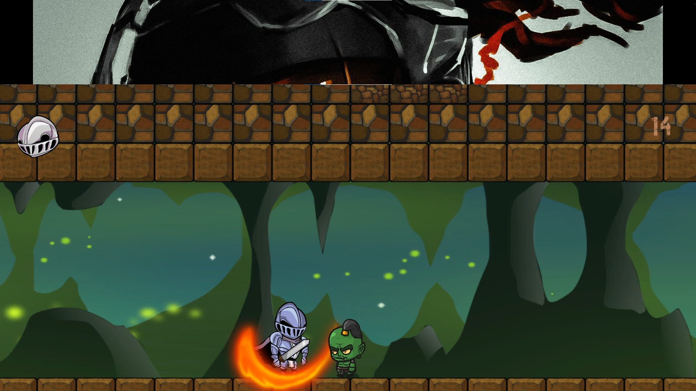

# Hi, I'm Óscar 👋

**Unity / Unreal Engineer** based in Madrid, Spain. I build engine plugins and the native code underneath them, in **C++** and **C#**.

At [HISPlayer](https://hisplayer.com/) I work on a commercial video-streaming SDK for **Unreal Engine** and **Unity** that runs on
Windows, macOS, iOS, Android, WebGL and Meta Quest. I'm the main developer of the Unreal plugin, and I work across the whole
stack: per-platform native layers, the public engine API, XR video, build pipelines and the sample projects we ship to clients.

I studied Video Game Development at Universidad Complutense de Madrid, so I'm comfortable as a generalist: engine architecture,
gameplay, tools, graphics and whatever else the team needs.

## What I work with

| | |
|---|---|
| **Languages** | C++ · C# · Python · Java · JavaScript · Objective-C · Lua · SQL |
| **Engines** | Unreal Engine 5 (C++, Blueprints, plugins) · Unity (C#, editor tooling, UPM, WebGL) · Godot |
| **XR & graphics** | Meta Quest · OpenXR · Vulkan · stereoscopic and 360° video · materials and shaders |
| **Platforms** | Windows / UWP · Android (Gradle, NDK / JNI) · iOS and macOS (Xcode) · Web |
| **Tools** | Git · Jira · Visual Studio · Android Studio · Xcode · Blender · Photoshop · Claude Code |

## Professional work (closed source)

- **Immersive video for Meta Quest:** stereoscopic and 360° playback, multi-stream sync, 8K video textures and ambisonic
  audio with head tracking, in Unreal (OpenXR / Vulkan) and Unity.
- **Cross-platform SDK APIs:** playback speed, ABR limits, subtitles and tracks, per-URL HTTP headers, hot content
  switching, low-latency WebRTC on WebGL.
- **Build and release tooling:** automated build of the precompiled Unreal plugin (Python) and a Unity editor tool that
  produces the packages for each store (Unity Asset Store, Fab).
- **WebGL tech demo:** a 3D environment with embedded video players, built in Unity →
  [play it in the browser](https://hisplayer-demos.s3.amazonaws.com/webgl-demo/webgl-demo-hisplayermonuments/index.html)

  
  

## University projects

### [Motor-Ola](https://github.com/OskarFreestyle/Motor-Ola-Recu) — C++ game engine
Entity-Component-System engine with Ogre3D rendering, PhysX physics, FMOD audio and SDL input. Scenes and prefabs are
defined in Lua, and the game is loaded as a DLL.

### [Articoding](https://github.com/OskarFreestyle/Articoding23-24) — final degree project
Educational Unity game that teaches programming through visual block coding, with a community where players share their
own levels. My degree project extended and improved the previous year's version.

  
  

### [Telemetry system](https://github.com/OskarFreestyle/UAJ-Grupo5-TelemetrySystem) — game analytics
C++ event tracker plus an [instrumented game](https://github.com/OskarFreestyle/UAJ-Grupo5-InstrumentalizedGame) used to
analyse player behaviour.

  
<b>More games</b>

### [DoppleBanger](https://github.com/C-Tas/DoppleBanger) — isometric action RPG (C++)
Pirate-themed action RPG: explore islands of increasing difficulty, defeat enemies and loot gear and treasure.

  
  

### [Goblin Slayer](https://github.com/while-true-studio/GoblinSlayer) — 2D hack 'n' slash (Unity / C#)
Side-scrolling action game set in goblin-infested caves, inspired by the anime of the same name.

  
  

## Contact

📧 oskarbmxfreestyle@gmail.com · 💼 [LinkedIn](https://www.linkedin.com/in/OscarFernandezRomano)
